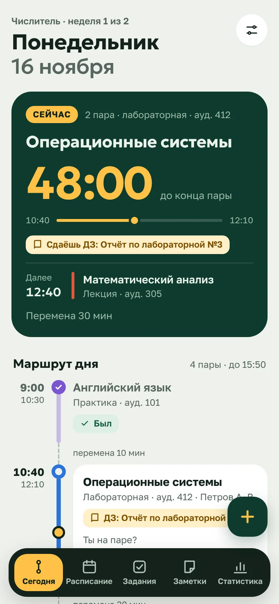
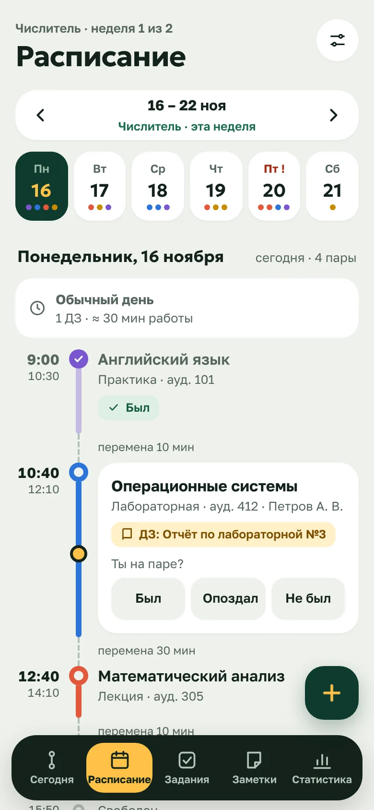
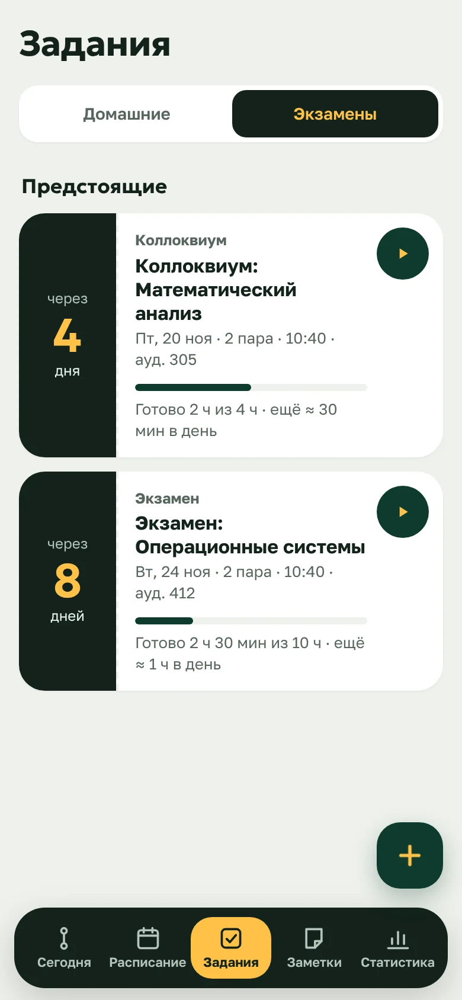
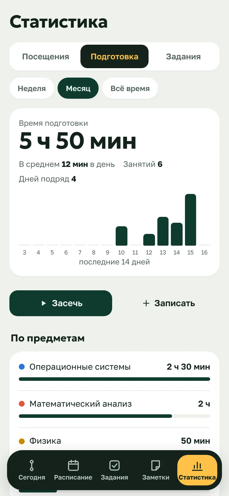
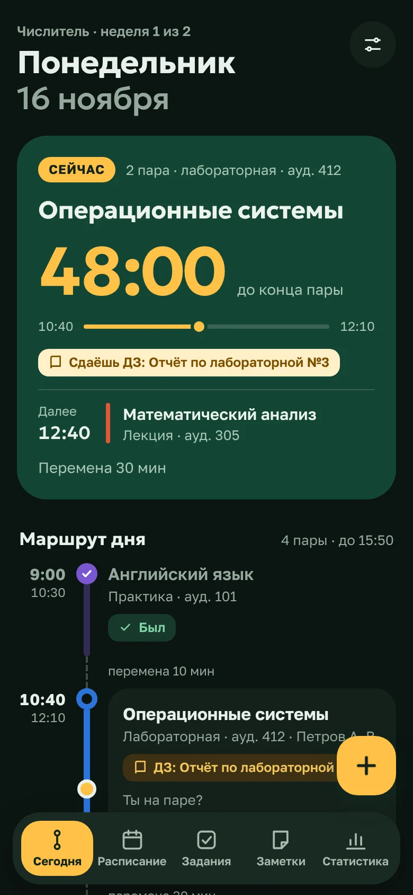
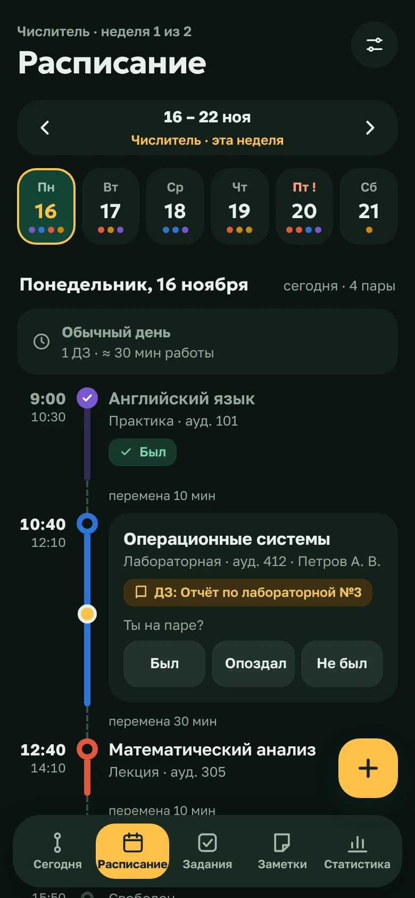
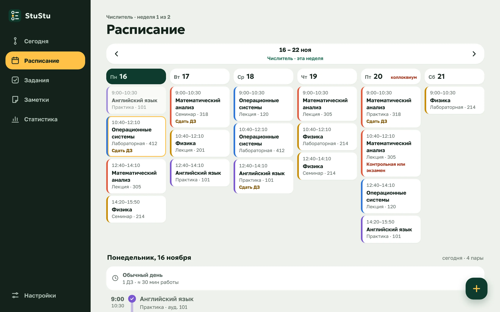

# StuStu

**Учебный планер для студента: какая пара идёт сейчас, что задали и сколько осталось до экзамена.**

День выглядит как маршрут: пары — остановки на линии, длина отрезка — длительность пары, жёлтая точка показывает, где ты сейчас.
Без регистрации и облака: всё хранится только на твоём устройстве.

### [Открыть приложение](https://stustu.whiskm.workers.dev/) · [Скачать для Android и Windows](../../releases/latest)

iPhone · Android · Windows · любой браузер

<table>
  <tr>
    <td></td>
    <td></td>
    <td></td>
  </tr>
  <tr>
    <td></td>
    <td></td>
    <td></td>
  </tr>
</table>

## Установка

| Устройство | Как установить |
|---|---|
| **iPhone и iPad** | Открыть [сайт](https://stustu.whiskm.workers.dev/) в Safari → «Поделиться» → «На экран „Домой“» |
| **Android** | Скачать `StuStu.apk` из [последнего релиза](../../releases/latest) |
| **Windows 10 и 11** | Скачать и запустить `StuStu_…_x64-setup.exe` из [последнего релиза](../../releases/latest) |
| **Любой компьютер** | Просто [открыть сайт](https://stustu.whiskm.workers.dev/) в браузере |

<b>iPhone и iPad</b>: подробно

App Store не нужен:

1. Открой в **Safari**: **[stustu.whiskm.workers.dev](https://stustu.whiskm.workers.dev/)**.
2. Нажми «Поделиться», затем **«На экран „Домой“»** и «Добавить».
3. StuStu откроется как обычное приложение, на весь экран, и будет работать без интернета.

Заполняй расписание уже в приложении со значка, а не в Safari: у значка на экране «Домой» своя память, и то, что введено во вкладке Safari, в нём не появится. Если данные уже введены в Safari, перенеси их резервной копией (см. [Перенос на другое устройство](#перенос-на-другое-устройство)).

<b>Android</b>: подробно

1. Открой [последний релиз](../../releases/latest) и скачай `StuStu.apk`.
2. Открой файл. Если телефон спросит, разреши установку из этого источника.

Новые версии ставятся так же, поверх старой. Если телефон откажется обновлять приложение, сохрани резервную копию, удали StuStu, поставь новую версию и загрузи копию.

Не хочешь ставить файл? Открой [сайт](https://stustu.whiskm.workers.dev/) в Chrome → меню ⋮ → «Установить приложение».

<b>Windows</b>: подробно

1. Открой [последний релиз](../../releases/latest) и скачай файл, который заканчивается на `_x64-setup.exe`.
2. Запусти его. Права администратора не нужны.
3. Если Windows покажет «Система Windows защитила ваш компьютер», нажми **«Подробнее» → «Выполнить в любом случае»**. Так бывает с любой программой без платной цифровой подписи.

StuStu появится в меню «Пуск». На широком экране меню разделов стоит слева, а расписание показывает всю неделю сразу.

## Что умеет

**Сегодня**
- **Табло текущей пары**: что идёт, в какой аудитории и сколько минут до конца. На перемене — отсчёт до следующей пары.
- **Маршрут дня**: все пары на одной линии с переменами и окнами. К паре прикреплено всё важное: ДЗ, которое на ней сдаёшь, контрольная, заметка.
- **Отметка посещения** прямо на линии: «Был», «Опоздал», «Не был».
- **Нагрузка на неделю**: какие дни будут тяжёлыми и сколько заниматься в день, чтобы всё успеть.

**Расписание**
- **Чередование недель**: одна, две, три или четыре недели в цикле (числитель и знаменатель с любыми названиями).
- **Своё время пар**: готовые шаблоны для вуза и школы или собственные звонки. Отдельной паре можно задать своё время.
- **Отмена пары на один день**, каникулы и выходные.
- **Меню пары**: одно нажатие — и можно записать ДЗ к следующему занятию, заметку или контрольную.

**Задания и экзамены**
- **ДЗ со сроком «к следующему семинару»**: StuStu сам находит нужную пару в расписании.
- **Экзамены, зачёты, контрольные, коллоквиумы** в виде билетов: слева крупно — сколько дней осталось.
- **Цель подготовки в часах**: приложение считает, сколько заниматься в день, и показывает, сколько уже сделано.
- **Таймер подготовки** с паузой или запись времени вручную.

**Статистика**
- **Посещаемость** по предметам и типам занятий, с подсказкой, где пропусков стало многовато.
- **Время подготовки**: по дням, по предметам, сколько дней подряд.
- **Задания**: сколько сдано в срок, сколько просрочено, какие дни впереди загружены.

**Заметки**
- К дню, к паре, к предмету, с повтором по расписанию или просто так. Важные закрепляются на главном экране.

**Под себя**
- Светлая и тёмная тема, цвет для каждого предмета.
- Что считать загруженным днём и за сколько дней задание становится срочным.

## Твои данные

**Всё хранится только на твоём устройстве.** Нет регистрации, серверов, рекламы и аналитики. Приложение не выходит в интернет: сайту он нужен только для первого открытия и обновлений.

### Резервные копии

Раз данные хранятся только на устройстве, иногда стоит делать копию: **Настройки → Сохранить резервную копию**. Если копии давно не было, StuStu напомнит об этом на главном экране.

Копия — это один файл. Его можно сохранить в «Файлы», на диск или отправить себе в мессенджер.

### Перенос на другое устройство

1. На старом устройстве: **Настройки → Сохранить резервную копию**.
2. Перешли файл себе любым способом.
3. На новом устройстве: **Настройки → Загрузить из файла** (или кнопка «Загрузить резервную копию» при первом запуске).

Так же переносятся данные из старого StuStu 2.0: новая версия читает его копии без потерь.

### Расписание для одногруппников

**Настройки → Поделиться расписанием** сохраняет в файл только расписание: предметы, пары, время звонков и каникулы. Одногруппник загружает его у себя, а его ДЗ, экзамены и заметки остаются на месте.

## Напоминания

StuStu показывает всё срочное при открытии, но сам уведомления не присылает. Чтобы телефон напоминал о парах, ДЗ и экзаменах, передай их в календарь:

1. **Настройки → Выгрузить в календарь**.
2. Выбери, что выгружать, и за сколько минут напоминать о паре.
3. Открой полученный файл: календарь телефона или компьютера предложит добавить события.

После этого напоминает сам календарь, даже когда StuStu закрыт. Если расписание изменилось, выгрузи файл ещё раз.

## Частые вопросы

<b>Нужна регистрация?</b>

Нет: открыл и пользуешься. Аккаунтов нет вообще, приложение не показывает рекламу и не собирает данные.

<b>Нужен ли интернет?</b>

Нет. Приложения для Android и Windows работают без интернета всегда, а сайт — после первого открытия.

<b>Можно пользоваться на телефоне и на компьютере одновременно?</b>

Да, но данные между устройствами сами не синхронизируются. Чтобы перенести их, сохрани копию на одном устройстве и загрузи на другом (см. [Перенос на другое устройство](#перенос-на-другое-устройство)).

<b>На iPhone пропали данные</b>

Чаще всего данные вводили во вкладке Safari, а потом открыли приложение со значка: у них разная память. Открой StuStu в Safari, сохрани резервную копию и загрузи её в приложении со значка.

Ещё Safari иногда очищает данные сайтов, которые давно не открывали. Со значка на экране «Домой» данные хранятся надёжнее, но резервную копию всё равно стоит делать.

<b>Почему Windows предупреждает при установке?</b>

Windows так встречает любую программу без платного сертификата подписи. Нажми **«Подробнее» → «Выполнить в любом случае»**.

<b>Как обновить приложение?</b>

- **iPhone и браузер**: при открытии появится плашка «Вышла новая версия StuStu» с кнопкой «Обновить».
- **Android и Windows**: скачай новую версию из [последнего релиза](../../releases/latest) и установи поверх старой. Данные сохранятся. Если Android откажется обновлять, см. раздел «Android: подробно» выше.

<b>У меня школа, а не вуз</b>

Подойдёт: в **Настройки → Время пар** есть шаблон «Школа: 7 уроков по 45 минут», а тип занятия можно выбрать «Урок».

## Благодарности

- Шрифты [Geologica](https://github.com/googlefonts/geologica) и [Golos Text](https://github.com/googlefonts/golos-text) — SIL Open Font License 1.1.
- Значки нарисованы по мотивам наборов [Feather](https://feathericons.com) (MIT) и [Lucide](https://lucide.dev) (ISC).

---

Разработчикам: как собрать приложение и выпускать версии — в [docs/DEVELOPMENT.md](docs/DEVELOPMENT.md).
